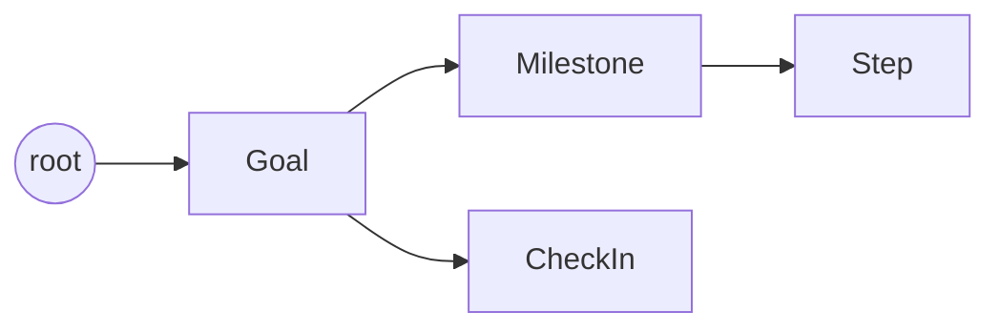

# 🌱 Hatua

**Hatua: one small step at a time.**
An AI goal coach that turns a big goal into small daily steps, checks in on how you feel, and makes the steps gentler on hard days. In English and Kiswahili.

## The problem

Many young people in Kenya have big goals: a first job, a new skill, saving money, getting fit. The hard part is the plan, not the dream. "Get a job in tech" is too big to start on today. When a week goes badly, most plans and apps don't adjust. They just pile up undone tasks, and people give up.

**Hatua is for young people in Kenya, including POD learners,** who want a patient coach that:

- breaks a goal into steps small enough to do in 15 minutes a day;
- notices when you're struggling and shrinks tomorrow's steps instead of piling on guilt;
- speaks your language: English or simple, everyday Kiswahili.

*Hatua* means "step" in Kiswahili.

## Features

- **AI plan:** describe a goal, why it matters and how many minutes a day you have. Hatua writes 3–5 milestones with small daily steps. You can add or delete your own steps and milestones.
- **Today:** the next 1–3 steps only, as big tick boxes, so there's no overwhelm.
- **Streak:** 🔥 the number of days in a row you've done at least one step.
- **Daily check-in:** pick 😀 Good / 😐 Okay / 😞 Hard and add a note. The AI coach replies in 2–3 warm sentences.
- **Adaptive steps:** on a hard day, or after 2 days with no progress, Hatua rewrites your next steps to be smaller and gentler. One tap on **Undo** brings the originals back.
- **Progress:** overall % done, a bar for each milestone, your streak and this week's check-ins.
- **Works when the AI doesn't:** if the AI is unreachable, goals about jobs, saving, fitness or learning get a built-in starter plan, and the coach falls back to a kind default message.
- **Mobile first:** one column on phones, 44px tap targets, and a collapsible goal list.
- **🇰🇪 EN / SW:** the switch in the header changes all interface text, and your choice is remembered. Each goal also has its own language: the AI writes that goal's plan and coach replies in English or Kiswahili.

## How Jac powers Hatua

Hatua is one [Jac](https://www.jaseci.org/) codebase. The data model, the API, the AI and the React interface all live in `main.jac`, with styles in `styles.css`.

### 1. The data is a graph

Goals, milestones, steps and check-ins are Jac **nodes** connected by edges, and they are saved automatically.



| Node | Key fields |
|---|---|
| `Goal` | title, why, minutes_per_day, language (`en`/`sw`) |
| `Milestone` | title |
| `Step` | text, done, done_on (date), original_text (kept when the coach adapts it) |
| `CheckIn` | mood, note, day, coach_reply, adapted |

Creating a node is `goal ++> Milestone(title=...)`. Querying is `[goal-->][?:CheckIn]`. Deleting a goal deletes all its milestones, steps and check-ins with `del`, so nothing is left orphaned.

### 2. `def:pub` functions are the API

Every `def:pub` function becomes an HTTP endpoint, and the React code calls it like a normal async function (`await get_today(goal_id)`). They return typed `obj` views rather than raw dicts.

| Endpoint | What it does |
|---|---|
| `create_goal`, `get_goals`, `delete_goal` | Create, list and delete goals |
| `plan_it` | Ask the AI for a plan (falls back to a built-in template offline) |
| `get_plan`, `add_milestone`, `add_step`, `toggle_step`, `delete_step` | Read and edit the plan |
| `get_today` | The next 1–3 unfinished steps |
| `get_streak` | Consecutive days with a ticked step |
| `add_checkin`, `get_checkins` | Save today's check-in (with the coach reply and adapting) and the last 7 |
| `restore_steps` | Undo the adapted steps |
| `get_progress` | Overall and per-milestone progress, streak, check-ins this week |
| `seed_demo` | Create one demo goal with history, for presentations (no AI) |

### 3. The AI is typed functions, via byLLM

With byLLM, an AI call is just a Jac function with `by llm()`. The `sem` description tells the model what to do, and the return type, such as `list[MilestonePlan]`, is enforced. The model is Gemini 2.5 Flash (set in `jac.toml`).

```jac
def plan_goal(goal: str, why: str, minutes_per_day: int, language: str)
    -> list[MilestonePlan] by llm(temperature=0.4);
```

| Function | Returns | `sem` (what the model is told) |
|---|---|---|
| `plan_goal` | `list[MilestonePlan]` | "You are Hatua, a warm, practical self-help goal coach. Break the user's big goal into 3 to 5 milestones… Every step must fit in minutes_per_day minutes. Write ALL text in the requested language… Never give medical, legal or financial advice." |
| `coach_message` | `str` | "Reply in 2-3 short sentences in the requested language… Acknowledge the feeling, mention the streak if it's above 0, and end with one tiny next action… If the note suggests the person is in crisis… mention they can call Kenya Red Cross on 1199." |
| `adapt_steps` | `list[str]` | "Rewrite each step to be smaller and gentler, doable in about half the daily time. Return exactly one rewritten step per input step, same order, same language." |

Every AI call is wrapped in `try`/`except`. A failure never loses data and never crashes the app.

### 4. The React interface lives in the same codebase, via jac-client

The UI is a Jac component (`def:pub app -> JsxElement`) with JSX, reactive `has` state and `can with entry` for loading data. jac-client compiles it to React and serves it with Vite, so there's no separate frontend project and no hand-written API client.

## Setup

1. **Install Jac 0.37.25** (Linux, macOS or WSL):
   ```bash
   curl -fsSL https://raw.githubusercontent.com/jaseci-labs/jaseci/main/scripts/install.sh | bash -s -- --version 0.37.25
   ```
2. **Get the code and install dependencies:**
   ```bash
   git clone https://github.com/ValaryJeruto/hatua-app.git
   cd hatua-app
   jac install
   ```
3. **Add your Gemini key.** Get a free one at [Google AI Studio](https://aistudio.google.com/apikey).
   ```bash
   cp .env.example .env
   # then edit .env:  GEMINI_API_KEY=your-real-key
   ```
4. **Run it:**
   ```bash
   jac run main.jac
   ```
5. Open **http://localhost:8000**. To try it without typing anything, click **Load demo** in the footer, or open http://localhost:8000/?demo=1.

Note: the free Gemini tier is small. At the time of writing it allowed about **5 requests per minute and 20 per day** for `gemini-2.5-flash`. Planning a goal uses 1 request; a "Hard" check-in uses 2–3, one for the reply plus one per milestone being adapted. When the limit is reached, Hatua keeps working with its offline plans and default coach replies.

## AI safety

- **No medical, legal or financial advice.** Every prompt says so. For health-related goals, plans stick to everyday habits and include a step to talk to a qualified professional. The saving-money plan covers everyday habits only.
- **Crisis-aware wording.** If a check-in note suggests someone is in crisis or thinking of harming themselves, the coach is instructed to respond with care, encourage them to talk to someone they trust, and mention the support line.
- **Support is always visible.** Every screen's footer says: *Need support? Call Kenya Red Cross on 1199.* (in English or Kiswahili).
- **Gentle by design.** Hard days make the steps smaller, never bigger, and the user can always undo an adapted plan.
- **Fails safely.** If the AI is unavailable, nothing breaks: check-ins are still saved, the coach sends a kind default message, and common goals get a hand-written starter plan.
- **Your key stays private.** `GEMINI_API_KEY` lives in `.env`, which is git-ignored.

## Screenshots

| Today | Plan |
|---|---|
|  |  |

| Coach check-in | Progress |
|---|---|
|  |  |

| Kiswahili | Phone |
|---|---|
|  |  |

---

Built by **Valary Jeruto**.
